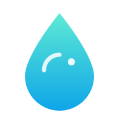

<div align="center">



# Durulaç

### Yapay ve bürokratik Türkçeyi duru bir dile çevirir; ne anlamını bozar ne bir şey uydurur.

    

</div>

Durulaç bir metni alır, içindeki yapay ve bürokratik kalıpları ayıklar, geriye yazarın kendi sesini bırakır. Cümleleri cilalayıp birbirine benzetmez; sayı, tarih ya da iddia uydurmaz. İstersen tek kelimeye dokunmadan sadece bakar: "Bu metin yapay mı?" diye sorarsan, bulduğu kalıpları tek tek, alıntısıyla gösterir.

Kuralları düz Markdown olduğu için tek bir modele bağlı değil. Claude Code, Claude Desktop ve web'de hazır beceri (skill) olarak çalışır; ChatGPT, OpenCode, OpenClaw ve Ollama gibi model ve araçlarda ise sistem yönergesi (system prompt) olarak kullanılır. Nitekim aşağıdaki testler DeepSeek, Qwen, GPT ve Claude ile yapıldı; hepsinde çalışıyor.

## İçindekiler

- [Sorun: yapay dil Türkçede başka türlü görünür](#sorun-yapay-dil-türkçede-başka-türlü-görünür)
- [Bir örnek](#bir-örnek)
- [Sekiz kip: hangisi ne işe yarar](#sekiz-kip-hangisi-ne-işe-yarar)
- [Finans metinleri](#finans-metinleri)
- [Akademik tez modu](#akademik-tez-modu)
- [Word izli değişiklik hattı](#word-izli-değişiklik-hattı)
- [Google SEO kipi (+seo)](#google-seo-kipi-seo)
- [Öğretim materyali kipi (+ogretim)](#öğretim-materyali-kipi-ogretim)
- [Bilgi koruma denetimi](#bilgi-koruma-denetimi)
- [Ne yapar, ne yapmaz](#ne-yapar-ne-yapmaz)
- [Kurulum](#kurulum)
- [Kullanım](#kullanım)
- [Nasıl sınandı](#nasıl-sınandı)
- [Sınırları](#sınırları)
- [Sürüm geçmişi](#sürüm-geçmişi)
- [Katkı](#katkı)
- [Lisans](#lisans)

## Sorun: yapay dil Türkçede başka türlü görünür

Yapaylık Türkçenin kendinde değil; yapay zekânın ve bürokrasinin ürettiği metinde. Üstelik bu metinlerin bıraktığı izler İngilizcedekinden farklıdır. Hazır "humanizer" araçları İngilizceye göre yazılmıştır; onların avladığı şeyler bizde pek işe yaramaz: aşırı uzun çizgi, "X is the Y of Z" kalıbı, birtakım İngilizce dolgu sözcükleri.

Yapay zekâ ve bürokrasi, Türkçede kendini başka yerlerden belli eder:

- İsimleştirme ve şişkin fiiller: "iyileştirilmesi amacıyla optimizasyonlar gerçekleştirilmiştir"
- Bürokratik edatlar: "hususunda", "nezdinde", "bu bağlamda"
- Kanıtsız övgü sıfatları: "yenilikçi, güçlü ve katma değerli çözümler"
- Her konuya uyan klişe girişler: "Günümüzün hızlı tempolu dünyasında..."
- Failini gizleyen edilgen cümleler ve boş vaatler: "hedeflenmektedir", "sağlanmış olup"

Durulaç bu izleri hazır bir listeyi çevirerek değil, Türkçeye göre ve TDK kurallarına dayanarak temizler.

## Bir örnek

Girdi (yapay, kurumsal bir paragraf):

> Günümüzün hızlı tempolu dünyasında, dijital dönüşüm süreçleri işletmeler açısından büyük önem arz etmektedir. Şirketimiz, müşteri memnuniyetini en üst düzeye çıkarmak amacıyla yenilikçi, güçlü ve katma değerli çözümler sunmaktadır. Bu bağlamda, geçtiğimiz dönemde birçok proje hayata geçirilmiş ve olumlu geri dönüşler alınmıştır.

Durulaç'tan sonra:

> Müşteri memnuniyeti bizim için öncelikli, çünkü işimizin sürekliliği ona bağlı. Geçtiğimiz dönemde birçok projeyi tamamladık ve kullanıcılardan olumlu dönüşler aldık.

Klişe giriş, "önem arz etmektedir", boş sıfat dizisi ve "bu bağlamda" çıkarıldı. Edilgen cümleler tek ve tutarlı bir "biz" sesine döndü; kopuk kalanlar bağlaçla birbirine bağlandı.

## Sekiz kip: hangisi ne işe yarar

Durulaç'ın 8 kipi var. **Ana kipler** metne ne yapılacağını seçer. **Ek kipler** ana kipin üstüne bir alanın
kurallarını ekler. Kip adını söylemen gerekmez; istekten anlaşılır. Her kipin zorunlu okuma dosyası `SKILL.md`'deki
tabloda yazılıdır.

| # | Kip | Türü | Ne yapar | Ne yapmaz | Nasıl çağrılır | Araç |
|---|---|---|---|---|---|---|
| 1 | **Temizle** | ana, varsayılan | Metni en az müdahaleyle yeniden yazar; tam metin + "Ne değiştirdim" listesi verir | Bilgi atmaz, olgu uydurmaz, doğal cümleye dokunmaz | "sadeleştir", "düzelt", "insanlaştır" | `tarama.py`, `bilgi_koruma.py` |
| 2 | **Tespit** | ana | Yapay/bürokratik kalıpları adıyla ve alıntısıyla gösterir | Yeniden yazmaz; yazar tahmini, yüzde ya da olasılık vermez | "AI mı yazdı?", "kalıpları göster" | `tarama.py` |
| 3 | **İstem iyileştir** | ana | Yapay zekâ istemine rol, bağlam, kısıt, çıktı biçimi ve doğrulama ekler; boşlukları `${değişken}` ile işaretler | Amacı değiştirmez, sahte örnek uydurmaz, metni dışarı göndermez | "bu promptu iyileştir" | — |
| 4 | **Özet** | ana | Sözcük/karakter sınırına uyar; korunacak sayıları ve sınırları tek tek arayıp geri koyar | Sınırı aşmaz, girdide olmayanı eklemez | "200 sözcükte özetle" | `bilgi_koruma.py` |
| 5 | **Finans** | ek | Banka, sigorta, yatırım ve şirket finansı metnini dört alt türe ayırır; rakamı, yasal terimi ve risk uyarısını korur; yasak getiri vaadini işaretler; okunabilirlik puanı verir | Uyum kararı vermez, hukuk görüşü değildir | "bu banka SMS'ini sadeleştir" | `okunabilirlik.py` |
| 6 | **Tez** (`--tur tez`) | ek | Eş dizim hatası, kaynaksız otorite, ad tamlaması zinciri, atıf–kaynakça uyumu ve kılavuz biçimini denetler; düzeltmeyi Word izli değişikliği olarak yazar; rapor cümlesizdir | Bilimsel değerlendirme yapmaz; jüri ya da danışman yerine geçmez | "tezimi denetle" | `tez_analiz.py`, `tez_onar.py` ve 8 yardımcı |
| 7 | **+seo** | ek | Temizledikten sonra konuyu başlığa ve ilk paragrafa koyar, yanıtı başa alır; title, meta, slug ve alt metin önerir | Sıralama vaadi, anahtar doldurma, uydurma veri yok; resmî, hukuk, tez, edebî, sohbet, altyazı ve sosyal medyada kapalı | "SEO uyumlu yap" | `seo_denetim.py` |
| 8 | **+ogretim** | ek | Ders notu, rehber ve PDF'i 32 bilim dalını ve görsel/sözel biçimi tanıyarak 8 boyutta puanlar (/16); yayınlanabilir mi diye karar verir | İçeriğin doğruluğunu ve dozun klinik doğruluğunu kanıtlamaz (elle madde kalır) | "ders notumu denetle", "bu PDF öğretir mi" | `ogretim_denetim.py` |

Metin türü kapısı her kipten önce çalışır. Resmî yazı, hukuk belgesi, akademik metin, haber, altyazı, sosyal medya ve
edebî metinde bazı kalıplar bilinçlidir ve dokunulmaz (ayrıntı: `references/tur-kapisi.md`).

## Finans metinleri

Banka, sigorta, yatırım ve şirket finansı metinlerinde hata iki yönlü olabilir. Yasal olarak aynen kalması gereken bir cümle değişebilir; ya da müşteriye giden karışık bir metin yeterince sadeleşmeyebilir. Durulaç bu yüzden önce metnin hangi finans türü olduğuna bakar:

| Tür | Örnek | Ne yapar |
|---|---|---|
| Yasal ibare ve bildirim | KAP açıklaması, sözleşme hükmü, risk uyarısı | Dokunmaz; yalnız açık yazım hatasını düzeltir. |
| Müşteri bilgilendirmesi | Banka SMS'i, kart mektubu, sigorta bildirimi | Cesurca sadeleştirir; rakamlara, yasal terimlere ve koşullara dokunmaz. |
| Yatırım içeriği ve pazarlama | Fon tanıtımı, kampanya | "Garantili getiri", "risksiz kazanç" gibi vaatleri ve dayanaksız performans iddialarını ayrı bir uyum notunda işaretler; risk uyarısını aynen bırakır. |
| İç yazışma ve rapor | Ekip e-postası, bütçe notu | Plaza İngilizcesini Türkçeleştirir; EBITDA, KDV gibi yerleşik kısaltmaları korur. |

Örnek, müşteri bilgilendirmesi:

> **Önce:** Asgari ödeme tutarı olan 1.250,00 TL'nin son ödeme tarihi olan 13.10.2026 tarihine kadar ödenmemesi halinde aylık %4,25 oranında gecikme faizi uygulanacaktır.
>
> **Sonra:** En az 1.250,00 TL'yi 13.10.2026'ya kadar ödeyin. Ödemezseniz aylık %4,25 gecikme faizi işler.

Tutar, tarih, oran ve "ödemezseniz" koşulu aynen kaldı; uzun cümle ikiye bölündü.

Bu türler için üç yardımcı dosya var:

- [`references/finans-terimleri.md`](references/finans-terimleri.md): 67 terim. Her birinin sade karşılığı ve aynen kalıp kalmayacağı yazılı ("yıllık maliyet oranı" aynen kalır, "ekstre" "hesap özeti" olur, "cash flow" "nakit akışı" olur).
- [`references/finans-mevzuat.md`](references/finans-mevzuat.md): Davranışın dayanağı (TCMB'nin sade dil hükmü, SPK'nın getiri garantisi yasağı, KAP'ın Türkçe kuralı) ve kaynak bağlantıları. Hukuk görüşü değildir.
- [`scripts/okunabilirlik.py`](scripts/okunabilirlik.py): Önceki ve sonraki metin için Ateşman ve Bezirci–Yılmaz okunabilirlik puanı verir. Ayrıca sayıları denetler: "1.250,00 TL" metinde "1.250 TL" ya da "1,5 milyon TL" "1,5 TL" olursa uyarır. Yalnız Python'un standart kütüphanesini kullanır.

- [`scripts/tarama.py`](scripts/tarama.py): Dosya hâlindeki düzyazıda kalıpları satır satır listeler; kod blokları, URL'ler ve tablo ayraçları taranmaz. `--onceki` ile eski sürümle kalıp başına önce → sonra sayısını karşılaştırır. Karar vermez, kontrol listesi üretir; resmî, akademik ve hukuk türünde (`--tur`) devre dışıdır. Okuyarak düzenlemenin kaçırdığı kalıpları yakalamak için eklendi ([Deney 8](docs/deneyler.md)).

```bash
python3 scripts/okunabilirlik.py once.txt sonra.txt
python3 scripts/tarama.py README.tr.md --onceki README.tr.eski.md
```

Testler: `scripts/` içindeki her `test_*.py` dosyası tek başına çalışır (`python3 -B scripts/test_tarama.py` gibi); ek kenar durum testleri için `python3 -m pytest scripts/tests`. Toplam 436 test vardır (345 unittest + 91 pytest) ve hepsi geçer.

## Akademik tez modu

Yüksek lisans ve doktora tezlerinde (`--tur tez`) kural tersine döner: edilgen çatı (`-ılmıştır`, `tarafından`), `kapsamında`, `söz konusu` gibi akademik kalıplar bilinçlidir, bu yüzden muaf tutulur. Bunun yerine tezlere özgü sorunlar aranır:

- **Çeviri kokusu ve eş dizim hataları:** "tehdit sergilemek" yerine "tehdit oluşturmak", "politika inşa etmek" yerine "politika geliştirmek", "boşluğu doldurmak" yerine "eksikliği gidermek". 105 kurallı [`references/akademik-esdizim.json`](references/akademik-esdizim.json) çekim eklerini soyarak çalışır (`scripts/esdizim.py`).
- **Kaynaksız otorite:** "Araştırmacılara göre" der ama cümlede `(Yazar, Yıl)` ya da `[1]` yoksa işaretlenir.
- **Ad tamlaması zinciri** (4 ve üzeri) ve **birinci şahıs sızıntısı** ("tezimizde", "ele aldık").
- **Atıf ↔ kaynakça çapraz denetimi** (`scripts/atif_tani.py`): metinde olup kaynakçada olmayan, kaynakçada olup metinde anılmayan, yılı birbirini tutmayan künyeler.
- **Tez yazım profili:** [`references/tez-yazim-kilavuzu.json`](references/tez-yazim-kilavuzu.json). Varsayılan değerler, bu beceriyi yazan kişinin tezinde uygulanan yazım kılavuzundan gelir (kurum adı yazılmamıştır). Başka bir kılavuza uyarlamak için aşağıdaki [uyarlama rehberine](#tez-profilini-kendi-kılavuzuna-uyarlama) bakın.

Hepsini tek raporda toplayan araç:

```bash
python3 scripts/tez_analiz.py Tez.docx                 # jüri/üslup raporu (varsayılan: cümlesiz)
python3 scripts/tez_analiz.py Tez.docx --cikti rapor.md
python3 scripts/tez_analiz.py yeni.md --onceki eski.md  # iki sürümü karşılaştırır
python3 scripts/tez_analiz.py Tez.docx --tam            # ifadeleri aynen yazar (yalnız kendi kullanımın için)
```

Varsayılan rapor **cümlesizdir**: tezin tek cümlesi bulunmaz, yalnız konum, kural kimliği, sayı ve geri döndürülemez kısa bir özet kalır. Raporu okuyan kişi ya da model metni görmez; bir bulut modeline tez yüklemek istemeyenler için tasarlandı. Alan beyaz listesi vardır, bir de sızıntı bekçisi: rapor yazılmadan önce tez gövdesinden ardışık beş sözcük arar, bulursa raporu yazmaz ve 3 koduyla çıkar. Testler bekçiyi kasten kapatıp testin kırıldığını da doğrular.

İstersen kendi Ollama sunucundaki bir modelden cümle önerisi de alınabilir: `DURULAC_UZAK_SSH` (ssh takma adı) ve `DURULAC_UZAK_MODEL` ortam değişkenlerini tanımlayıp `--uzak` ver. Bu bayrak, eş dizim bulunan cümlelerden birini (en çok 500 karakter) senin verdiğin ssh takma adına gönderir; bayrak ya da değişken yoksa hiçbir şey gönderilmez. [`references/Modelfile.durulac-tez.sablon`](references/Modelfile.durulac-tez.sablon) kendi temel modeline bağlayacağın bir şablondur; hazır bir model dağıtılmaz.

## Tez profilini kendi kılavuzuna uyarlama

Tez denetimi (`scripts/tez_analiz.py`) ve Word onarımı (`scripts/tez_onar.py`) kuralları **tek bir profilden** okur. **Varsayılan profil**, bu beceriyi yazan kişinin kendi tezinde uygulanan kılavuzun değerleridir (kurum adı yok); sizin enstitünüz farklı ise yalnız profili değiştirmeniz yeterlidir, kodu değil.

**Üç yol (öncelik sırasıyla):**
1. Python'dan: `kilavuz.yukle("/yol/profilim.json")`.
2. Ortam değişkeni: `DURULAC_TEZ_PROFIL=/yol/profilim.json python3 scripts/tez_analiz.py ...` — kendi JSON'unuza yalnız **değiştirdiğiniz anahtarları** yazmanız yeter; eksikler varsayılandan tamamlanır.
3. `references/tez-yazim-kilavuzu.json` dosyasını doğrudan düzenlemek.

Daha gevşek, APA benzeri hazır bir örnek: [`references/tez-yazim-kilavuzu.ornek-genel.json`](references/tez-yazim-kilavuzu.ornek-genel.json) (`DURULAC_TEZ_PROFIL` ile seçilir).

**Neyi nereden değiştirirsiniz** (anahtarlar `tez-yazim-kilavuzu.json` içindedir; varsayılan değer parantezde):

| Kılavuzunuzdaki kural | JSON anahtarı | Varsayılan | Denetim kodu |
|---|---|---|---|
| Kenar boşlukları (cm) | `sayfa_duzeni.ust_kenar_cm`, `alt_kenar_cm`, `dis_kenar_cm`, `ic_kenar_cm`, `kenar_toleransi_cm` | 2,5 / 2,5 / 2,5 / **4,0** / 0,15 | `tez_analiz.kilavuz_denetimi` (§6); `tez_onar --kenar` üst kenarı kullanır |
| Özet / Abstract kelime sınırı | `ozet.min_kelime`, `ozet.maks_kelime` | **250–400** | `kilavuz_denetimi` (§5) |
| Tablo adı ("Tablo" mu "Çizelge" mi) | `sekil_tablo.tablo_adi` | **Çizelge** | `kilavuz_denetimi` (§3) |
| Tablo ve "Çizelge" karışık kullanımı uyarısı | `sekil_tablo.karisik_ad_uyar` | açık | aynı |
| Bölüm numaralı şekil (Şekil 1.1) uyarısı | `sekil_tablo.bolum_numarali_uyar` | **açık** (sıralı numara ister) | aynı |
| Atıf sayfa biçimi | `atif.sayfa_bicimi`: `"iki_nokta"` → `(Soyad, 2014: 102)`, `"apa7"` → `(Soyad, 2014, s. 102)` | `iki_nokta` | `kilavuz_denetimi` (§4) ve `tez_onar` ATIF_SAYFA kuralı (profil `apa7` ise kapanır) |
| `&` ve "ve diğerleri" uyarıları | `atif.ampersand_uyar`, `atif.ve_digerleri_uyar` | açık | `kilavuz_denetimi` (§4) |
| 1. düzey başlık TAMAMI BÜYÜK, alt başlıkta bağlaç küçük, numaradan sonra boşluk | `baslik.duzey1_buyuk_harf`, `alt_duzey_baglac_kucuk`, `numara_sonrasi_bosluk` | açık / açık / açık | `kilavuz_denetimi` (§2) |
| Eş anlamlı terimlerde tek terim (kanun/yasa …) | `terim_birligi_ciftleri` (liste; `terim_a`, `terim_b`) | 8 çift | `kilavuz_denetimi` (§1) |
| Kaynakça alt başlıkları (KİTAPLAR, MAKALELER …) | `kaynakca.alt_baslik_zorunlu`, `kaynakca.alt_basliklar` | **zorunlu** | `kilavuz_denetimi` (§7) |
| Özgeçmişte yasak kişisel veri | `kvkk_yasakli_bilgiler` (yalnız bilgi; kontrol kodda: e-posta, telefon, doğum/adres/kimlik/ORCID) | 6 madde | `kilavuz_denetimi` (§8) |

**Profile bağlı olmayan, kodda sabit kalanlar** (başka bir kılavuz için kodu değiştirmeniz gerekir):
- `tez_onar.py` başlık düzeltmeleri (BASLIK_BOSLUK, BASLIK_BUYUK) yalnız **Romen rakamlı** birinci düzey başlıklara (`IX. SONUÇ`) uygulanır. Ondalık numaralı başlıklarda (`1.`, `1.1`) çalışmaz.
- KVKK denetimi (e-posta, telefon, doğum tarihi/yeri, adres, kimlik, ORCID) `tez_analiz.py` içindeki düzenli ifadelerle yapılır; JSON'daki `kvkk_yasakli_bilgiler` listesi açıklayıcıdır.
- Yazı tipi, punto, satır aralığı gibi **biçim** değerleri (`sayfa_duzeni.yazi_tipi` vb.) profilde belgelenmiştir ama otomatik denetlenmez; yalnız kenar boşlukları denetlenir.
- Kelime mantığı (eş dizim) kuralları kılavuzdan bağımsızdır: `references/akademik-esdizim.json`.
- `references/Modelfile.durulac-tez.sablon` ve `scripts/egitim_hazirla.py` içindeki örnekler varsayılan profili anlatır; profili değiştirirseniz bu metinleri de güncelleyin.

**Doğrulama:** profil değiştirdikten sonra `cd scripts && python3 -I -m pytest -q`. Testler profil dosyasının varsayılanlarla uyumunu ve ortam değişkeni ile profil seçimini kontrol eder.

## Word izli değişiklik hattı

Tez metnine dokunacak her şey Word'ün **izli değişikliği** olarak yazılır (yazar etiketi `Durulaç-Ajan`); reddedersen orijinal geri gelir. Orijinal dosya hiç değişmez, yeni `.docx` yazılır. Bu betikler yalnız Python standart kütüphanesiyle çalışır:

| Betik | İş |
|---|---|
| `tez_onar.py` | Kural tabanlı onarım: yazım ve biçim düzeltmeleri, izli değişiklik olarak |
| `denetci.py` | Özgün ve ajan çıktısını karşılaştırır; sayı, atıf, özel ad ve cümle sayısı kaybını yakalar |
| `benzerlik.py` | Quetext raporundaki atıfsız ve yüksek benzerlikli eşleşmeleri yerel Ollama modeliyle yeniden kurar (izli değişiklik); kaynak künyesi uydurmaz, atıf yerini işaretler. Rapor cümlesizdir |
| `yerlestir.py` | Onaylanmış yeni paragrafı gömme (embedding) benzerliğiyle en yakın gövde paragrafının ardına koyar; eşik altındaysa yerleştirmez |
| `intihal.py` | Tez ile verdiğin korpus arasında yerel benzerlik ön kontrolü (Python 3.12+). Turnitin gibi geniş veri tabanlarının yerini tutmaz; korpus eksikse tespit de eksiktir |
| `icerik.py`, `rapor_ozet.py` | Konu listesi kapsama kontrolü ve Quetext PDF raporundan cümlesiz özet (`pdftotext` gerekir) |
| `tez_ajan.py` | Yukarıdakileri tek kök dizinde, `ayar.json` ile yöneten görev koşturucu (`TEZ_AJAN_KOK`); adında “orijinal” geçen dosyayla çalışmayı reddeder |

`yerlestir.py` gömme için yerel Ollama'da `bge-m3` kullanır. Betikler 127.0.0.1 dışına çıkmaz; tek istisna yukarıdaki açık `--uzak` bayrağıdır.

## Google SEO kipi (+seo)

"Bu yazıyı sadeleştir ve Google için SEO uyumlu yap" dendiğinde Durulaç önce her zamanki temizliği yapar, sonra metni arama için düzenler:

- konuyu başlıkta ve ilk paragrafta açıkça adlandırır,
- soruya yanıt veren metinde yanıtı başa alır,
- uzun metne ara başlık koyar,
- title, meta açıklama, slug ve görsel alt metni önerir.

Metinde olmayan bilgiyi uydurmaz. Google'ın değer verdiği ama metinde bulunmayan özgün veri, tarih, yazar ya da deneyim gibi öğeleri en çok üç soruyla size sorar.

Neyi yapmadığı da kuralın parçasıdır:

- Sıralama vaadi vermez.
- Anahtar sözcük yoğunluğu hedeflemez. Google'ın böyle bir hedefi yok; John Mueller: "Keyword density does not matter, but being explicit does matter".
- Anahtar sözcüğü metne doldurmaz.
- Resmî yazı, hukuk, tez, edebî metin, sohbet, altyazı ve sosyal medyada SEO uygulamaz.

Kurallar kaynaklarıyla birlikte `references/seo.md` dosyasındadır. `scripts/seo_denetim.py` 20 maddelik bir denetçidir. Başlık, ilk paragraf, anahtar doldurma, title ve meta uzunluğu, başlık sırası, alt metin, slug ve çapa metnini Türkçe çekim eklerini tanıyarak denetler. Bulguları üç düzeyde verir: Google kuralı, sektör sezgisi, Durulaç kuralı.

```bash
python3 scripts/seo_denetim.py yazi.md --anahtar "asgari ödeme tutarı" --baslik "Title" --aciklama "Meta" --slug asgari-odeme-tutari
```

## Öğretim materyali kipi (+ogretim)

Öğrenciye giden belgeyi (ders notu, konu anlatımı, rehber, ezber kitapçığı, kelime listesi, PDF) kanıta dayalı bir
ölçekle denetler. Tek kiptir ama **belgenin alanını tanır**: tıp notunu yabancı dil ölçeğiyle, görsel bir anatomi
atlasını düz metin ölçeğiyle değerlendirmez.

**8 boyut** (her biri 0 hata · 1 uyarı · 2 temiz; toplam /16): doğruluk, hedefle uyum, seviye, ezber ve kavrama,
okunaklılık, sıra ve akış, kendini sınama, verimlilik. Otomatik denetimde **HATA** varsa karar "yayınlanamaz"dır.

**Her alanda aynı kalan çekirdek:** yabancı alfabe harfi karışması, bitmemiş yer işareti, geçerli TC kimlik numarası,
başlık numarası sırası, sayfa göndermesi, kendini sınama bölümü, görselde alt metin, PDF'te yazı boyu (8 pt altı
hata), boş ve yarım sayfa, sayfa tavanı. Dayanağı Sweller (bilişsel yük), Mayer (çoklu ortam), Dunlosky (kendini
sınama ve aralıklı tekrar).

**32 alan profili:**

| Grup | Alanlar |
|---|---|
| Sağlık (en ayrıntılı) | tıp; alt alanları diş hekimliği, hemşirelik ve ebelik, eczacılık, veteriner, beslenme, fizyoterapi, acil tıp; ayrıca psikoloji |
| Sayısal ve fen | matematik, istatistik, fen, fizik, kimya, biyoloji, yer bilimleri, ziraat, mühendislik, bilgisayar, mimarlık |
| Sosyal ve beşerî | hukuk, iktisat ve işletme, tarih, coğrafya, sosyal bilgiler, ilahiyat, edebiyat, felsefe, sanat ve müzik, eğitim bilimleri |
| Dil ve genel | yabancı dil (fr, en, de, es, it), genel |

**Sağlıkta neler denetlenir:**

- **Yayını durdurur:** dozda sondaki sıfır ("5,0 mg") ve baştaki sıfırsız ondalık (",5 mg"), hasta adı ya da protokol
  numarası.
- **Uyarı verir:**
  - ISMP'nin karıştırılmaya açık kısaltmaları (U, IU, cc, q.d., μg, SC, TIW, D/C, OD/OS/OU, doz önünde > <);
  - zaman birimi yazılmamış "mg/kg" dozu;
  - harfli gebelik kategorisi (FDA bunu 2015'te kaldırdı);
  - aynı analitin dönüşüm yazılmadan iki birimle verilmesi;
  - kaynaksız referans aralığı;
  - yılsız ya da 5 yıldan eski kılavuz;
  - DSM-IV;
  - yanlış yazılmış tür adı;
  - tanımsız kısaltma.
- **Alt alanlara özgü:**
  - veteriner: türü yazılmamış doz, gıda hayvanında arınma süresinin olmaması;
  - beslenme: "kalori" yazımı, besine hastalık tedavi etme özelliği yükleme;
  - hemşirelik: bakım planında eksik aşama;
  - fizyoterapi: FITT öğesi eksik egzersiz reçetesi.
- **Elle kontrol listesi:** her sağlık alanına ayrıca 10 madde eklenir. Örnekleri: yüksek riskli ilaçlarda çift
  kontrol, benzer adlı ilaçlar, çocuk dozu, kimliksizleştirme ve onam, kılavuz sürümü.

**Öteki alanlardan örnekler:**

- SI birim yazımı ("Kg" → "kg", "5kg" → "5 kg");
- deney föyünde güvenlik notu;
- "p = 0,000" yazımı;
- Python 2 ve sürümsüz kod örneği;
- yürürlükten kalkmış kanun (818, 1086 ve 6762 sayılı kanunlar yayını durdurur);
- künyesiz Yargıtay kararı;
- kaynaksız hadis ve numarasız âyet meali;
- kaynaksız doğrudan alıntı;
- künyesiz eser görseli;
- ölçeksiz teknik çizim;
- haritada lejant, ölçek, kuzey oku ya da kaynak eksikliği;
- yılsız istatistik.

```bash
python3 scripts/ogretim_denetim.py ders-notu.md                    # alanı kendisi bulur
python3 scripts/ogretim_denetim.py not.md --pdf not.pdf --alan tip # PDF ölçümü ve alanı zorla
python3 scripts/ogretim_denetim.py not.md --json                   # makine okur
```

**Kanıt:** üç quoteproof araştırması yapıldı (toplam 23 başlık, 872 bulgu, 567'si kaynağında otomatik doğrulandı).
Kurala giren kritik bilgiler ayrıca elle açıldı. Kaynağı açılamayan hiçbir bilgi HATA kuralı yapılmadı. Bunlar en çok
UYARI olabildi; örneğin 765 sayılı TCK ve PSNet vakası. Ayrıntı:

- [`references/ogretim.md`](references/ogretim.md): ölçek, eşikler, alan tabloları;
- [`references/ogretim-alanlari.json`](references/ogretim-alanlari.json): profiller; yeni alan bu dosyaya eklenir;
- [`docs/ogretim-alan-kanitlari.md`](docs/ogretim-alan-kanitlari.md): alıntılı kanıt ve açılamayanlar.

**Sınırı:** betik yazımı ve yapıyı denetler; dozun, tanının, kanun yorumunun ya da tarihsel bilginin doğru olduğunu
kanıtlamaz. Bunlar her alanın elle listesinde kalır.

## Bilgi koruma denetimi

`scripts/bilgi_koruma.py` yalnız finansta değil her Temizle işinde çalışır. Önce ve sonra metnini karşılaştırır, kaybolan sayıyı, alıntıyı, özel adı ve atfı listeler. Uzunluk sınırı geldiğinde (“en çok 30 sözcük”) karşı açıklamanın, kaynak atfının, toplam sayının ve hedef bilgisinin düşmesini önlemek için eklendi: 23 Ekim 2026'da 42 maddelik bir bültende kısaltma 17 maddede bu bilgileri düşürmüştü ve betik hepsini yakaladı.

```bash
python3 scripts/bilgi_koruma.py once.txt sonra.txt
```

## Ne yapar, ne yapmaz

Yapar:

- Metnin türünü önce belirler ve her türe kendi kuralıyla yaklaşır. Resmî yazı, dilekçe, akademik makale ve sözleşmede o türe özgü kalıplar (edilgen çatı, "arz ederim", "işbu") bilinçlidir; onlara dokunmaz. Haberde kaynak atfını, altyazıda kısa satırları, sosyal medyada hashtag ve emojiyi, edebî metinde devrik cümleyi korur.
- Sohbeti sohbet bırakır. Devrik cümleyi, günlük dolguyu, "bence" gibi yumuşatıcıları ve kişisel sesi rapor diline çevirmez.
- Onlarca yapay/bürokratik kalıbı tanır (61–66 numaralı kalıplar yalnız tez modunda): klişe giriş, boş sıfat dizisi, plaza İngilizcesi, sahte-derin kapanış ve daha fazlası. Yerleşik olmayan eş dizimleri de düzeltir ("etki üretmek" yerine "etki yaratmak").
- Bir şey silerken yerine akış bırakır. Dolgu attığında cümleleri kopuk kopuk bırakmaz, bağlaçla toparlar.
- Sadeleştirir, özetlemez. Kelime yükünü azaltır ama bilgi taşıyan cümleyi atmaz.
- Finans metninde rakamları, yasal terimleri ve zorunlu uyarıları korur; yatırım reklamındaki yasak vaatleri işaretler.
- Öğretim materyalinde formüle, doza, diş numarasına, kanun numarasına ve yabancı dildeki örnek cümleye dokunmaz; yalnız Türkçe açıklamayı sadeleştirir.

Yapmaz:

- Kod bloklarına, komutlara, tablolara ve teknik adlara karışmaz.
- "commit", "pull request" gibi kavram adlarını çevirmez; yalnız "merge etmek" gibi plaza fiillerini Türkçeleştirir ("birleştirmek").
- Metinde olmayan sayıyı, tarihi ya da iddiayı asla uydurmaz. Kanıtsız iddiayı ya işaretler ya da çıkarır.
- Zaten doğal olan cümleyi güya iyileştirmek için ellemez.
- Uyum kararı vermez. Finans metninde riskli ifadeyi işaretler, kararı uyum birimine bırakır.

## Kurulum

Beceri klasörüne klonlamak yeterli:

```bash
git clone https://github.com/mesutbsdgn/turkce-ai-durulac.git ~/.claude/skills/turkce-ai-durulac
```

Beceri dizinin farklıysa (örneğin `~/.agents/skills/`) oraya klonla. Claude bir sonraki oturumda beceriyi kendiliğinden tanır.

**Başka bir modelde ya da araçta (ChatGPT, OpenCode, OpenClaw, Ollama…):** kurulum gerekmez. `SKILL.md` dosyasının içeriğini sistem yönergesi (system prompt / özel talimat) olarak yapıştır. SKILL.md 1.5'ten beri kısadır; ayrıntı `references/` altındadır: tam kalıp kataloğu için `references/kaliplar.md`, finans metni için `references/finans.md` ve `references/finans-terimleri.md`, istem iyileştirme için `references/istem-iyilestirme.md`, tez için `references/tez-modu.md`, SEO için `references/seo.md`, öğretim materyali için `references/ogretim.md` dosyasını da ekle; ince ayar istiyorsan `references/degistirme-sozlugu.md` sözlüğünü ekle. Okunabilirlik betiği Python 3 ister; betiği çalıştıramayan ortamda puan istenmez. Model bunları okuyup aynı kurallarla çalışır. Zayıf modeller kuralları daha eksik uygular; kurumsal/resmî metinde güçlü bir model tercih et.

## Kullanım

Doğal dille istemen yeterli; dilersen adıyla da çağırabilirsin:

```
/turkce-ai-durulac
Şu metni sadeleştir: <metin>
```

Birkaç örnek istek:

- "Bu duyurunun kurumsal kokusunu al." Temizle biçiminde çalışır.
- "Bu paragraf yapay mı, kalıpları göster." Tespit biçiminde çalışır, metne dokunmaz.
- "Şu mesajı sadeleştir." Sohbet tonunu korur, resmîleştirmez.
- "Bu teknik yazıyı düzelt." Kodu ve terimleri bırakır, yalnız düzyazıyı toparlar.
- "Bu banka SMS'ini sadeleştir." Rakamları ve yasal terimleri koruyarak sadeleştirir, okunabilirlik puanını verir.
- "Bu fon tanıtımında sorun var mı?" Yasak vaatleri ve dayanaksız iddiaları uyum notunda gösterir.
- "Bu farmakoloji notumu denetle." Tıp profilini seçer; doz yazımını, kısaltmaları ve hasta kimliğini denetler, yayın kararı verir.
- "Hukuk ders notum güncel mi?" Mülga kanun, numarasız kanun adı ve künyesiz kararı işaretler.
- "Bu promptu güçlendir." İstem iyileştir kipiyle çalışır, düzyazı kurallarını uygulamaz.

## Nasıl sınandı

Durulaç körü körüne "iyidir" denmedi; birkaç turluk kontrollü deneyle ölçüldü. Farklı modeller (DeepSeek, Qwen, GPT-6 Luna) aynı metinleri hem beceriyle hem becerisiz temizledi, bağımsız bir model (Claude Sonnet) sonuçları kör puanladı. Ardından Claude Opus 4.8 kırmızı takım gözüyle yedi sistematik eksik buldu; hepsi kapatıldı. Sonraki turda dört yeni tür kapısı (altyazı, sosyal medya, haber, edebî) ve yeni kalıplar eklendi, aynı koşullarda yinelenen testte gerileme çıkmadı (güçlü uygulayıcıda ortalama 9,9/10). Ardından sözlük derinleştirmesi A/B testiyle seçildi. v1.3'teki finans eklentisi GPT-6 Luna ile kör denendi (15 metin) ve ayrıca koda ve kurallara yönelik bir incelemeden geçti; bulunan hatalar düzeltildikten sonra yinelenen denemede hepsi kapandı.

Öğrendiklerimiz:

- Farklı modellerle çalışması, becerinin tek bir modele bağlı olmadığını da gösterdi.
- Becerinin asıl katkısı yalnızca kalıp silmek değil, güçlü bir modelin fazla düzeltmesini frenlemek. Modelin teknik terimi ya da sohbet tonunu bozmasını engelliyor.
- Zayıf bir modelin gözünden kaçan boş sıfatları ve klişeleri yakalatıyor.
- Uydurma yasağı hem uygulayan hem puanlayan modelce doğrulandı: üslup düzeliyor ama metne olgu eklenmiyor.

Bütün deney kayıtları [`docs/deneyler.md`](docs/deneyler.md) dosyasında. Örneklem küçük ve puanlar bir modelin yargısı olduğundan sonuçlar kesin ölçü değil, yön gösterir.

## Sınırları

- Sonuç uygulayan modele bağlı. Güçlü bir model beceri olmadan da iyi yazabilir; kurumsal metin temizliğinde güçlü bir model önerilir.
- Beceri bir korkuluktur, sihirli değnek değil. Aradığın hatayı temizler, ama güzel üslubu garanti etmez.
- Son söz sende. Altındaki değişiklik listesini oku, onaylamadığını geri al.
- Finans eklentisi hukuk ya da uyum danışmanlığı değildir. Mevzuat notundaki bazı madde numaraları ikincil kaynakla doğrulandı ve dosyada öyle işaretli; resmî kullanımda aslından kontrol et.
- Tarama betiği bağlamı bilmez: doğru kullanımı da işaretleyebilir ve bulmadığı kalıbı (anlam, ritim, fail) bulmaz. Bulguları gerekçeyle karara bağla.
- Tez modu bir danışman ya da jüri yerine geçmez. Bulduğu şey kural ihlali ve olası çeviri kokusudur, bilimsel değerlendirme değil. Eş dizim kuralları derlenmiş bir listedir (`korpus_pmi.py` onu bir korpusla genişletmek içindir, listedeki kurallar yayımlanmış bir korpusa dayanmaz); her kuralın örneği var ama kapsam dar, bulmadığı hatayı yok sayma.
- Yerel küçük bir modelin (7-8 milyar parametre) akademik cümleyi yeniden yazması denendi; bu sürümde modelin kalitesi ölçülmedi, bu yüzden model önerisi **isteğe bağlı bir ek** olarak bırakıldı. Asıl denetim 0-token betiklerdedir; bir modeli tezde kullanmadan önce kendi örneklerinle ölç.
- `+ogretim` alanı sözcüklere bakarak tahmin eder; karma bir belgede yanılabilir. Belgenin başına `alan: tip` yazarak ya da `--alan` ile düzeltilir. Sağlıkta yazım güvenliğini denetler, klinik doğruluğu değil.
- Okunabilirlik formülleri sözcük ve hece uzunluğuna bakar, anlamı ölçmez. Kısa metinde puan oynaktır; puanı tek başına başarı ölçüsü sayma.

## Sürüm geçmişi

| Sürüm | Tarih | Değişiklik |
|---|---|---|
| v1.1 | 29 Eyl 2026 | Model bağımsız kullanım, yeni tür kapıları |
| v1.2 | 3 Eki 2026 | İstem iyileştir modu |
| v1.3 | 3 Eki 2026 | Finans eklentisi |
| v1.4 | 8 Kas 2026 | Akademik tez modu, bilgi koruma, Word izli değişiklik |
| v1.5 | 17 Kas 2026 | SKILL.md küçültüldü (51 KB → 16 KB), ayrıntı `references/` altına taşındı |
| v1.6 | 20 Kas 2026 | Google SEO kipi (`+seo`) |
| v1.6.1 | 20 Kas 2026 | Slug önerisinde kesme işareti düzeltmesi |
| v1.7.0 | 22 Kas 2026 | `+ogretim` kipi: öğretim materyali ölçeği (8 boyut, /16), `ogretim_denetim.py`, `references/ogretim.md` |
| v1.9.0 | 22 Kas 2026 | `+ogretim` 32 alana çıktı (sağlıkta 8 alan ve ortak sağlık grubu, fen, mühendislik, bilgisayar, hukuk, iktisat, beşerî bilimler); TC kimlik ve hasta kimliği denetimi; README'de 8 kip tablosu |
| v1.8.0 | 22 Kas 2026 | `+ogretim` alanı tanıyor: dil, tıp, diş, matematik, fen, tarih, coğrafya, sosyal, genel profilleri ve görsel/sözel biçim; `ogretim-alanlari.json`, alan kanıt özeti |

Not: v1.5 ve v1.6 commit iletilerinde yanlışlıkla "1.1.0" ve "1.2.0" yazıyor; doğru numaralar bu tablodakilerdir.

## Katkı

Yeni bir kalıp, sözlük eşlemesi ya da "şuna dokunmamalı" örneği önereceksen issue veya pull request aç. Her kalıp için sorunu, kötü bir örneği ve düzeltilmiş halini ver; dayanağını TDK'ye bağla. Metinde olmayan bir olguyu uyduran örnek kabul edilmez.

## Lisans

Kullanım hakkı lisansı: Durulaç'ı ajanlarınızla ve uygulamalarla **kullanabilirsiniz**; kopyalamak, yeniden dağıtmak, değiştirmek, satmak ve model eğitiminde kullanmak yasaktır. Tam metin: [LICENSE](LICENSE). Telif © 2026 mesutbsdgn.

Önceki sürümleri o günkü lisansla edinenlerin hakları sürer: `v1.3` etiketine kadar MIT, 9 Ekim 2026'dan bu lisansa geçişe kadar GNU AGPL-3.0. Bu lisans, onu getiren commit'ten itibaren yayımlanan sürümler içindir. MIT lisanslı çalışmalardan uyarlanan parçaların bildirimi [THIRD-PARTY-NOTICES.md](THIRD-PARTY-NOTICES.md) dosyasında durur ve korunur.

Finans terim listesinin yapısı [sal-keskin/okunabilir](https://github.com/sal-keskin/okunabilir) (MIT) projesinden esinlendi; içerik kopyalanmadı. Okunabilirlik formülleri (Ateşman 1997, Bezirci–Yılmaz 2010) yayımlanmış hâllerinden sıfırdan yazıldı.

Yapısı [petergyang/no-ai-slop](https://github.com/petergyang/no-ai-slop) (MIT) projesinden esinlendi; İngilizce içerik kopyalanmadı, her şey Türkçeye özgün yazıldı. Değiştirme sözlüğü [Denomas/Turkce-yazim-denetimi](https://github.com/Denomas/Turkce-yazim-denetimi) (MIT) kurallarından seçilerek uyarlandı. Dil bilgisi ve noktalama [TDK Yazım Kılavuzu](https://tdk.gov.tr/) temel alındı. Ayrıntılı notlar: [LICENSE-NOTES.md](LICENSE-NOTES.md).
